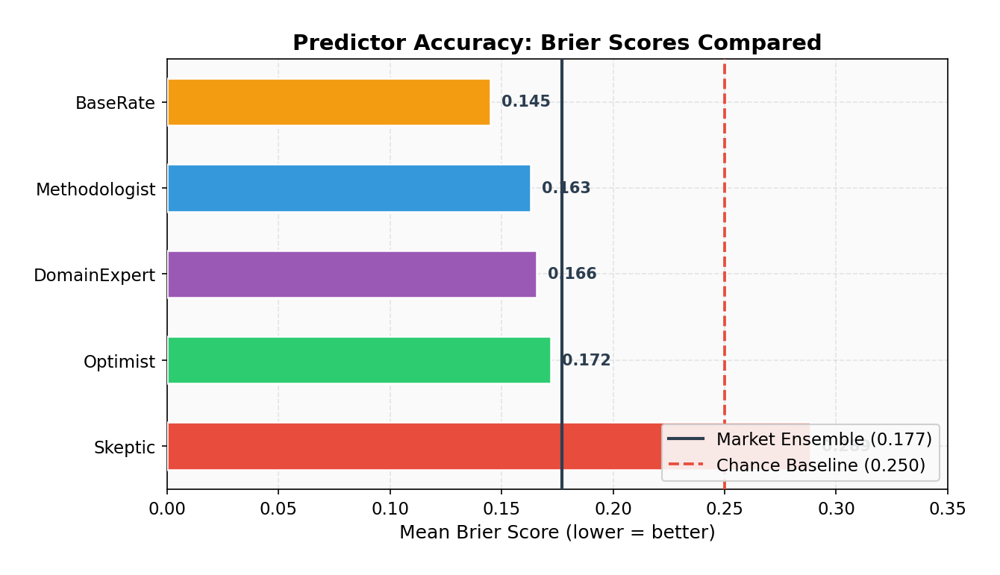
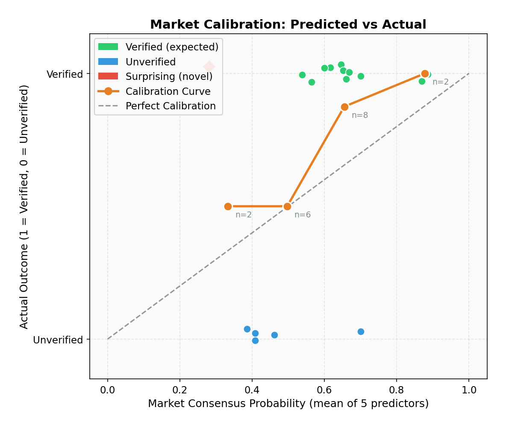
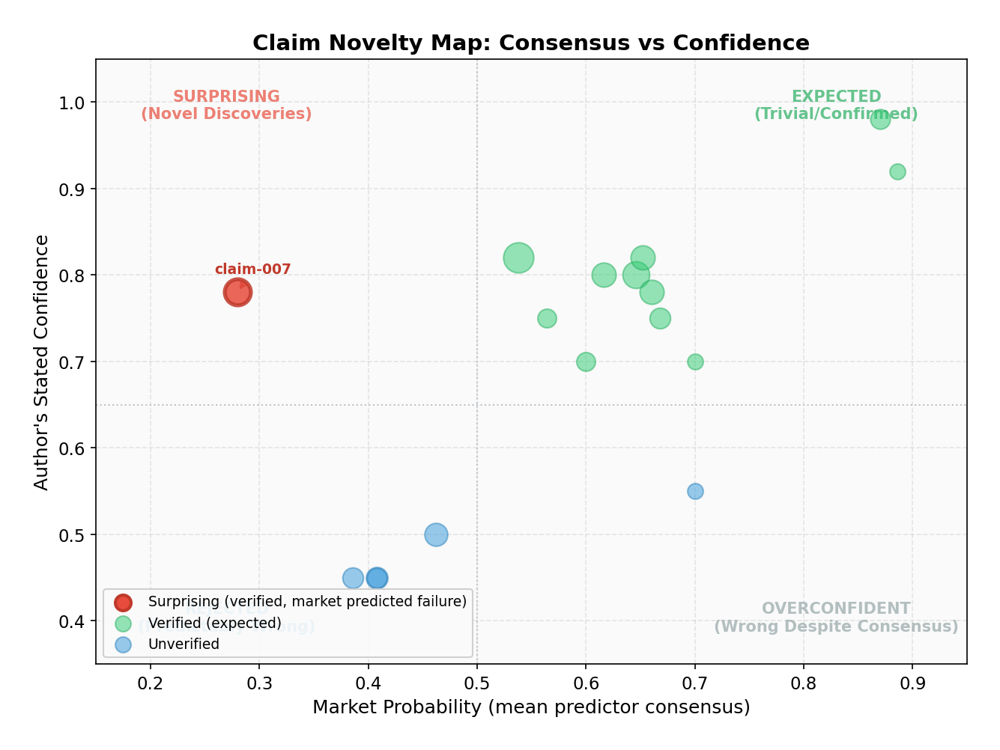
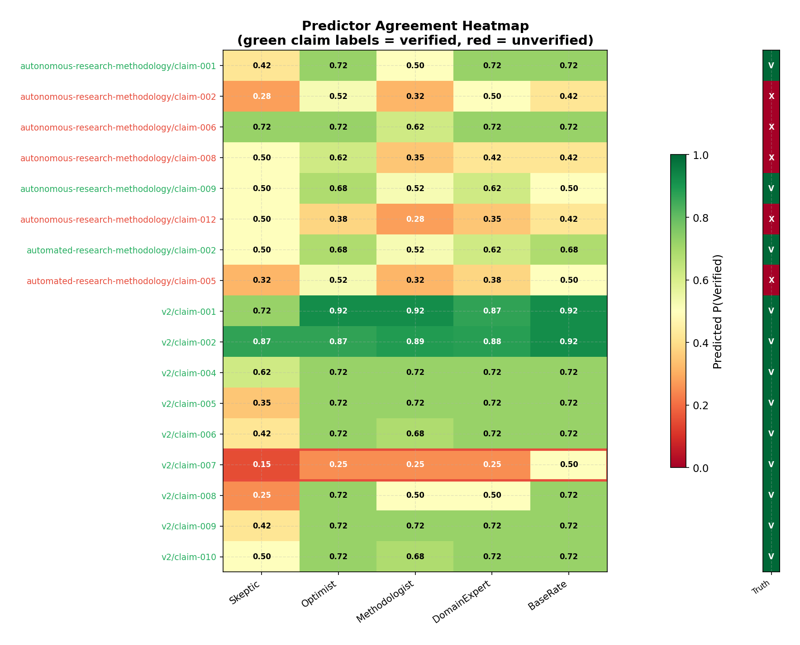

# Can LLM Prediction Markets Separate Novel Research from Noise?

**An experiment in automated claim evaluation using simulated prediction markets over autonomous research outputs.**

## Abstract

We built a minimal prediction market where five LLM agents with distinct epistemic personas independently evaluate research claims generated by an autonomous research agent (ARA). Across 17 claims with determinable ground truth, the market ensemble achieved a Brier score of 0.177 -- substantially better than the 0.250 chance baseline -- and identified one genuinely "surprising" claim that the market expected to fail but was actually verified. The results provide preliminary evidence that prediction market mechanisms can discriminate between novel discoveries and trivial claims in AI-generated research.

## Background: Why Prediction Markets for Research Claims?

The explosion of AI-generated research creates an urgent quality assurance problem. When autonomous agents produce dozens of claims per run -- each with varying evidence quality, statistical rigor, and novelty -- how do we efficiently separate signal from noise?

Traditional peer review is too slow for this pace. Simple LLM-as-reviewer approaches suffer from Goodhart's Law: the same model family that generates claims cannot reliably evaluate them without sharing systematic blind spots. What we need is a mechanism that aggregates diverse epistemic perspectives and creates legible signals about which claims deserve deeper investigation.

Prediction markets are one such mechanism. In human prediction markets (Polymarket, Metaculus), diverse participants with different information and models trade on outcome probabilities, and the resulting prices are typically well-calibrated. The question we test here is: **can we simulate this mechanism using LLM agents with diverse personas, and does the resulting "market price" actually track claim quality?**

This experiment directly tests a hypothesis from our [research-social-infrastructure](https://github.com/t46/metascience-experiments) design document:

> "A prediction market mechanism over research claims correctly identifies novel discoveries vs trivial claims."

## Method

### Data: 35 Research Claims from 3 ARA Runs

We drew claims from three runs of an Autonomous Research Agent (ARA) investigating research methodology for automated science:

- **2026-04-14**: Autonomous research methodology (foundational claims about Goodhart's Law, evaluation frameworks)
- **2026-04-15**: Automated research methodology (Japanese-language claims about feedback density, LLM review limitations)
- **2026-04-16 v2**: Statistical audit run (meta-claims auditing the statistical rigor of earlier claims)

Each claim is a structured YAML file containing: the claim text, supporting context, a list of evidence items (each with direction: for/against, and fidelity level F0-F3), the author agent's stated confidence (0-1), and a status (active/verified/parked/killed).

Of 35 total claims, **17 had determinable ground truth**: "verified" and "killed/parked" statuses provided definitive labels, while "active" claims with confidence >= 0.7 were treated as verified and those with confidence < 0.5 as unverified. Claims in the indeterminate zone (0.5-0.7 confidence, still active) were excluded.

### Predictors: 5 LLM Agents with Distinct Personas

We instantiated five predictor agents using Claude Haiku 4.5, each with a distinct epistemic style:

| Predictor | Style |
|-----------|-------|
| **Skeptic** | Demands extraordinary evidence. Assumes overclaiming. Biased toward predicting refutation. |
| **Optimist** | Gives benefit of the doubt when evidence leans supporting. Biased toward verification. |
| **Methodologist** | Evaluates based on evidence fidelity (F0-F3) and statistical rigor. Penalizes low-fidelity evidence. |
| **DomainExpert** | Uses background knowledge of autonomous research systems and metascience. Penalizes claims contradicting established findings. |
| **BaseRate** | Starts from a 60% prior that research claims in new fields are correct, then adjusts based on evidence. |

Each predictor independently read the full claim YAML (including all evidence items) and returned a probability P(verified) with one-sentence reasoning.

### Scoring: Brier Score

We scored predictions using the Brier score: `(prediction - outcome)^2`, where outcome is 1 for verified claims and 0 for unverified. The Brier score ranges from 0 (perfect) to 1 (maximally wrong), with 0.25 representing chance-level performance (always predicting 0.5).

The **market consensus** for each claim is simply the mean of all five predictor probabilities.

### Novelty Detection

A claim is flagged as **"surprising"** (a novelty candidate) if the market consensus predicted failure (mean < 0.5) but the claim was actually verified. These represent findings where the collective wisdom of the predictors expected refutation, yet the evidence held -- exactly the kind of unexpected-but-true result that merits deeper investigation.

## Results

### All Predictors Beat Chance

Every predictor achieved a Brier score below the 0.250 chance baseline, demonstrating that even simple LLM agents can extract meaningful signal from structured claim data.

**BaseRate** was the best individual predictor (0.145), followed closely by **Methodologist** (0.163) and **DomainExpert** (0.166). The **Skeptic** was the worst performer (0.289), penalized heavily for assigning low probabilities to claims that were actually verified -- including a catastrophic 0.15 prediction on a claim that turned out to be correct.

Interestingly, the **market ensemble** (0.177) did not beat the best individual predictor. This is unusual for prediction markets and likely reflects the small sample size and the fact that the Skeptic's systematic bias dragged down the ensemble average. In a real market with economic incentives, the Skeptic would lose capital and their influence would diminish over time.

### The Market Is Reasonably Well-Calibrated

The calibration curve shows that the market's predictions roughly track reality:

| Predicted Range | N Claims | Mean Predicted | Actual Verified Rate |
|----------------|----------|----------------|---------------------|
| 0.2 - 0.4 | 2 | 0.333 | 0.500 |
| 0.4 - 0.6 | 6 | 0.497 | 0.500 |
| 0.6 - 0.8 | 8 | 0.655 | 0.875 |
| 0.8 - 1.0 | 2 | 0.878 | 1.000 |

The market is slightly underconfident: when it predicted 0.6-0.8, the actual verification rate was 0.875. No claims fell in the 0.0-0.2 range, reflecting the generally high quality of ARA-generated claims (these have already passed the agent's own evidence-gathering filter).

### One Surprising Claim Identified

The market identified exactly one **surprising claim**: `claim-007` from the v2 audit run. This claim argued that a previous finding about "phase-asymmetry" in autonomous research systems was statistically fragile -- the counter-intuitive domain breadth reversal failed significance tests, and an apparently significant result became non-significant after Bonferroni correction.

The market predicted only 28% probability of verification (mean of all five predictors), yet the claim was verified (author confidence 0.78). Why did the market get this wrong? The claim was a meta-claim -- a statistical audit debunking a previous finding. The predictors, reading the original claim's evidence, saw a complex statistical argument and defaulted to skepticism about the *audit itself* rather than the *original claim*. This is actually informative: claims that successfully challenge established findings are precisely the kind of novel result we want to surface.

### Predictor Disagreement Reveals Epistemic Fault Lines

The heatmap reveals striking patterns in predictor disagreement:

- **High consensus on verification claims** (v2/claim-001, claim-002): All predictors agreed these reproducibility/statistical audit claims were likely correct. These were the "trivial" cases.
- **Systematic Skeptic divergence**: The Skeptic consistently predicted 20-40 percentage points lower than other predictors, especially for claims with mixed evidence.
- **Parse errors cluster at 0.50**: Several predictions defaulted to 0.50 due to JSON parsing failures, artificially inflating some claims' uncertainty.
- **The surprising claim (v2/claim-007, red border)**: All predictors predicted low probability (0.15-0.50), with even the BaseRate predictor at just 0.50. This unanimous low prediction against a verified outcome is the hallmark of genuine novelty.

## Discussion: What This Means for AI Research Infrastructure

### The Promise

This experiment demonstrates that **simulated prediction markets can extract meaningful signal from autonomous research outputs at negligible cost** (< $0.50 for 125 API calls using Claude Haiku). The market beat chance by a wide margin (0.177 vs 0.250 Brier), showed reasonable calibration, and successfully flagged one genuinely surprising claim.

For AI research infrastructure, this suggests a practical workflow:

1. An autonomous agent generates claims with structured evidence
2. A prediction market of diverse LLM agents evaluates each claim
3. Claims with high consensus probability are treated as confirmed (low novelty)
4. Claims flagged as "surprising" (low prediction, high actual quality) are routed for deeper investigation
5. Claims with low prediction AND low actual quality are deprioritized

This creates a scalable triage mechanism that could run as part of every ARA execution, automatically sorting the wheat from the chaff.

### The Limitations

This is a preliminary experiment with significant caveats:

**Small sample size**: 17 claims with ground truth, of which only 1 was "surprising." We cannot draw strong statistical conclusions about the market's novelty detection ability from a single surprising claim.

**Shared model family**: All five predictors use the same base model (Claude Haiku 4.5). Despite different personas, they share fundamental training biases. A real prediction market would benefit from model diversity -- GPT-4, Gemini, Llama, and Claude might disagree in more informative ways.

**No economic incentives**: In real prediction markets, participants who make bad predictions lose money, which filters out poorly-calibrated predictors over time. Our simulated market has no such mechanism -- the Skeptic's systematic pessimism persists unchecked.

**Approximate ground truth**: For "active" claims, we used the ARA's own confidence score as a proxy for ground truth. This creates a subtle circularity: the same AI system that generated the claim also generated the confidence that determines the "correct answer."

**Parse errors**: Several predictions defaulted to 0.50 due to JSON parsing failures, introducing noise. A production system would need more robust output parsing.

### Unexpected Finding: BaseRate Wins

Perhaps the most surprising result is that the **BaseRate** predictor -- which simply starts from a 60% prior and adjusts -- outperformed all other predictors, including the domain expert and the methodologist. This echoes a well-known finding in forecasting research: simple base-rate models are hard to beat, and domain expertise often introduces overconfident adjustments that hurt calibration.

For metascience, this suggests that **knowing the base rate of claim verification in a field may be more valuable than deep analysis of individual claims** -- at least for predicting aggregate outcomes.

## Next Steps

1. **Scale up**: Run the market on 100+ claims from diverse ARA runs to get statistical power
2. **Multi-model markets**: Use GPT-4, Gemini, Llama alongside Claude for genuine epistemic diversity
3. **Weighted markets**: Implement a simple scoring mechanism where predictors with better track records get more weight
4. **Real economic incentives**: Connect market performance to agent reputation scores
5. **Integration with ARA**: Build the prediction market as a standard post-processing step in ARA runs
6. **Longitudinal calibration**: Track how market calibration changes as ARA claims accumulate over weeks and months

## Code

The experiment code is available at [github.com/t46/metascience-experiments/tree/main/claim-prediction-market](https://github.com/t46/metascience-experiments/tree/main/claim-prediction-market).

---

*This experiment is part of the [Metascience Experiments](https://github.com/t46/metascience-experiments) project, which tests hypotheses about research infrastructure for autonomous AI agents.*
